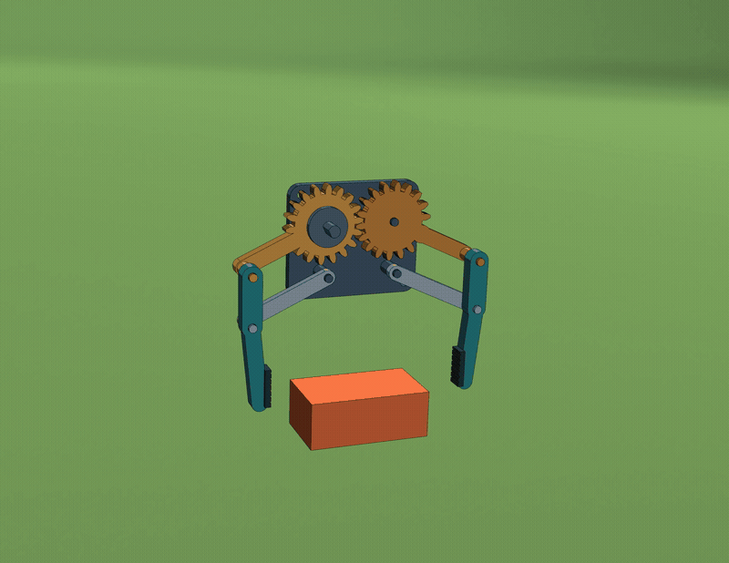

# Robotics midterm

Gadzhi Askhabaliev

1. `1_ros_navigation` — path planner for the Unity mobile robot. ROS 2.
2. `2_ur3_forward_kinematics` — UR3 forward kinematics, MuJoCo model of the UR3 CB3.
3. `3_ur3_inverse_kinematics` — UR3 inverse kinematics on the same DH model.
4. `4_parallel_gripper` — parallel gripper in SolidWorks (`Assem1.SLDASM` + `PG_*.SLDPRT`). Motion:

